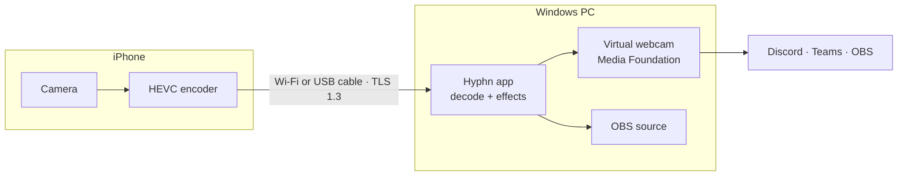

<div align="center">


# Hyphn

**Your iPhone, as your PC's webcam. Locally.**

Pair your iPhone with your Windows PC with a QR code. Use it as a 4K60 webcam in Discord, Teams and OBS, and send your photos to your PC, over Wi-Fi or cable, with no account and no cloud.

[](https://github.com/1oma1e/Hyphn/releases/latest)


[](LICENSE.md)

[**Download**](https://github.com/1oma1e/Hyphn/releases/latest) · [Install](#install) · [Features](#features) · [Build from source](#build-from-source)

</div>

---

## Features

| | |
|---|---|
| 📷 **Cam** | Your iPhone becomes a Windows webcam named **Hyphn**, seen by Discord, OBS and any app that uses a webcam. Up to **4K60 in HEVC**, about **130 ms** end to end by cable. |
| ✨ **Effects** | Background blur or replacement, film looks, face emojis and 3D hats, all computed on your PC. Your picture never leaves your home. |
| 🌙 **Waiting screen** | Paused or disconnected? Your call sees an animated neon screen with a message, translated offline into the language you pick. |
| 📤 **Drop** | Send photos and videos from the iPhone to the PC in original quality, sorted by year and month, with duplicates flagged. |
| 🔋 **Phone status** | Battery, temperature and storage of the iPhone, right on the PC. |
| 🔒 **Private by design** | QR code pairing, TLS 1.3 with pinned keys, local network or USB cable only. No account, no server, no telemetry. |
| 🔄 **Auto updates** | The PC app offers each new release in one click. SideStore shows iPhone updates. |
| 🌍 **English and French** | English by default. The PC app switches to French in Settings; the iPhone app follows the iPhone's language. |

## Install

**What you need:** a Windows 11 PC, an iPhone on iOS 17 or later, its USB cable, and about 30 minutes. Everything is free. You only do this once.

Hyphn is not on the App Store: the iPhone app is installed with **SideStore**, using a free Apple account made just for it.

### 1. Create a spare Apple account (on the PC)

This account is only used to install Hyphn. Your real Apple account is never used.

1. Go to [account.apple.com](https://account.apple.com) and click **Create Your Apple Account**.
2. Fill in your name, country, birth date, a **new email address**, a new password and your phone number.
3. Type the code you get by email, then the one you get by text message.

✅ Your Apple ID is this email. Write it down with the password.

### 2. Install Hyphn on the PC

1. Open the [latest release](https://github.com/1oma1e/Hyphn/releases/latest).
2. Under **Assets**, download `Hyphn_<version>_x64-setup.exe` and open it.
3. Blue window "Windows protected your PC"? Click **More info**, then **Run anyway**.
4. Click **Yes**, then **Next**, **Install** and **Finish**.
5. A firewall window? Click **Allow**.
6. Open the **Microsoft Store**, search for **Apple Devices** and click **Get**. (It lets the PC talk to the iPhone over the cable.)

### 3. Get the iPhone ready

1. The iPhone needs a passcode: **Settings** › **Face ID & Passcode**.
2. Plug the iPhone into the PC. On the iPhone, tap **Trust**, then type your passcode.

### 4. Install SideStore (on the PC)

1. Download **iloader** from [iloader.app](https://iloader.app) and install it.
2. Open iloader and sign in with the email and password from step 1.
3. Got a 6-digit code? Type it in iloader.
4. Choose **SideStore (Stable)** in the installers list.
5. Wait for the message that SideStore is installed.

### 5. Allow SideStore (on the iPhone)

1. **Settings** › **Privacy & Security** › **Developer Mode**: turn it on, then tap **Restart**.
2. After the restart, tap **Turn On** and type your passcode.
3. **Settings** › **General** › **VPN & Device Management**.
4. Tap your email, then **Trust**, and **Trust** again.

### 6. Local VPN (on the iPhone)

SideStore needs it. Nothing goes to the internet: it stays on your iPhone.

1. Install **LocalDevVPN** from the App Store.
2. Open it, tap connect, then **Allow** and type your passcode.

✅ "VPN" shows at the top of the screen.

### 7. Install Hyphn (on the iPhone)

1. Open **SideStore**, go to the **Sources** tab and tap **+**.
2. Paste this address and confirm:
   ```
   https://raw.githubusercontent.com/1oma1e/Hyphn/main/source.json
   ```
3. Go to the **Browse** tab, tap **Hyphn**, then **FREE**.

✅ Hyphn is on your home screen.

### 8. Pair the PC and the iPhone

1. PC: open Hyphn and click **Pair an iPhone**. A QR code shows up.
2. iPhone: open Hyphn. It says **Scan your PC's QR code**: point it at the code on the PC.
3. Allow **Local Network** and **Camera** when asked.
4. Check that the PC and the iPhone show the same 4-digit code, then tap **Yes, Pair** on the iPhone.

✅ They are paired, and they reconnect on their own from now on.

### 9. Use it in Discord

**User Settings** › **Voice & Video** › **Camera** › **Hyphn**. Teams, OBS and other apps work the same way.

### Good to know

- ⏰ **Every 7 days**, apps installed with a free Apple account must be refreshed: connect LocalDevVPN, then **SideStore** › **My Apps** › **Refresh All**. If you forget, Hyphn won't open, but nothing is lost: **Refresh All** fixes it. To never think about it, set up the shortcut below.
- 💻 **PC updates**: a card shows up when Hyphn starts › **Install**.
- 📱 **iPhone updates**: **SideStore** › **My Apps** › **Update**.
- 🔑 Always keep the **same Apple account** in SideStore.
- 🌍 Hyphn is in English. To switch the PC app to French: **Settings** › **Language** › **Français**. The iPhone app follows the iPhone's language.

<details>
<summary><b>🔁 Refresh Hyphn automatically (5 minutes, once)</b></summary>

This shortcut does the 7-day refresh for you, twice a week.

**1. Create the shortcut**
1. Open the **Shortcuts** app, **Shortcuts** tab, tap **+** at the top right.
2. Tap the name at the top › **Rename** › type `Refresh Hyphn`.
3. Add these 5 actions in this order (use the search bar at the bottom):
   1. **Set VPN**: tap **VPN** and pick **LocalDevVPN**, set it to **Connect**.
   2. **Wait**: **3** seconds.
   3. **Refresh All Apps** (from SideStore).
   4. **Set VPN** again: **LocalDevVPN**, **Disconnect**.
   5. **Show Notification**, with the text `✅ Hyphn refreshed for 7 days`.
4. Tap **Done**.

**2. Test it once**

Tap the **Refresh Hyphn** shortcut.
✅ The VPN turns on, SideStore refreshes, the VPN turns off, then the notification shows up.
If iOS asks for access to SideStore or the VPN: **Always Allow**.

**3. Make it run on its own**
1. **Shortcuts** › **Automation** tab › **+**.
2. **Time of Day** › **20:00** › **Weekly** › tick **Monday** and **Thursday**.
3. Choose **Run Immediately**.
4. Turn off **Notify When Run** (your own notification is enough).
5. **Next** › pick **Refresh Hyphn**.

✅ The refresh now happens twice a week without you touching anything.

⚠️ If one day the ✅ notification does not come: open **SideStore** › **My Apps** › **Refresh All** by hand.
</details>

## How it works



- **PC app**: [Tauri 2](https://tauri.app) (Rust + web UI), webcam DLL in C++ for the Windows Frame Server, OBS plugin.
- **iPhone app**: SwiftUI, built on Linux with [xtool](https://github.com/xtool-org/xtool).
- **Protocol**: Protocol Buffers over a pinned TLS 1.3 link; discovery by Bonjour, or usbmux over the cable.

## Build from source

<details>
<summary>PC app (Windows)</summary>

Requirements: Node.js, Rust (MSVC toolchain), Visual Studio Build Tools.

```bash
cd apps/desktop
npm install
npm run dev        # run the app
npm run build      # webcam DLL + setup
cd src-tauri && cargo test
```
</details>

<details>
<summary>iPhone app</summary>

Built with xtool (Swift 6, iOS SDK extracted from Xcode) in Docker, see `infra/xtool/`.

```bash
cd apps/ios
xtool dev build
```
</details>

## Project layout

```
apps/desktop        PC app (Tauri: Rust in src-tauri/, UI in ui/)
apps/desktop-vcam   Windows virtual webcam DLL (C++)
apps/obs-plugin     OBS source plugin (C++)
apps/ios            iPhone app (SwiftUI)
protocol            Shared Protocol Buffers messages (hyphn.proto)
docs                Design notes and decisions (French, Obsidian vault)
tools               Build, release and docs scripts
```

## Status

Personal project, in active development. Tested on an iPhone 16 Pro Max and Windows 11. Android may come later.

## License

Hyphn is **source-available, not open source**: [PolyForm Strict 1.0.0](LICENSE.md).

- ✅ You may download, install and use Hyphn for free, for any non-commercial purpose.
- ✅ You may read the code to learn from it.
- ❌ You may not redistribute it, modify it, build on it, or sell it.

Copyright © 2026 [1oma1e](https://github.com/1oma1e). For any other use, open an issue to ask.

## Credits

MediaPipe (Apache 2.0), three.js (MIT), 3D models from Poly Pizza (CC-BY 3.0 / CC0) and background photos are credited in the `CREDITS.txt` file of each folder under `apps/desktop/ui/vendor/`.

<div align="center"><sub>Made by <a href="https://github.com/1oma1e">1oma1e</a></sub></div>
