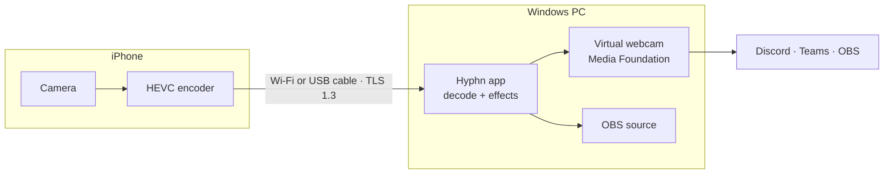

<div align="center">


# Hyphn

**Your iPhone, as your PC's webcam. Locally.**

Pair your iPhone with your Windows PC with a QR code. Use it as a 4K60 webcam in Discord, Teams and OBS, and send your photos to your PC, over Wi-Fi or cable, with no account and no cloud.

[](https://github.com/1oma1e/Hyphn/releases/latest)


[**Download**](https://github.com/1oma1e/Hyphn/releases/latest) · [Install](#install) · [Features](#features) · [Build from source](#build-from-source)

</div>

---

## Features

| | |
|---|---|
| 📷 **Cam** | Your iPhone becomes a Windows webcam named **Hyphn**, seen by Discord, OBS and any app that uses a webcam. Up to **4K60 in HEVC**, about **130 ms** end to end by cable. |
| ✨ **Effects** | Background blur or replacement, film looks, face emojis and 3D hats, all computed on your PC. Your picture never leaves your home. |
| 🌙 **Waiting screen** | Paused or disconnected? Your call sees an animated neon screen with a message, translated offline into the language you pick. |
| 📤 **Drop** | Send photos and videos from the iPhone to the PC in original quality, sorted by year and month, with duplicates flagged. |
| 🔋 **Phone status** | Battery, temperature and storage of the iPhone, right on the PC. |
| 🔒 **Private by design** | QR code pairing, TLS 1.3 with pinned keys, local network or USB cable only. No account, no server, no telemetry. |
| 🔄 **Auto updates** | The PC app offers each new release in one click. SideStore shows iPhone updates. |

## Install

You need a **Windows 11 PC**, an **iPhone on iOS 17 or later**, a USB cable for the first setup, and a free Apple ID.

**PC**
1. Download `Hyphn_<version>_x64-setup.exe` from the [latest release](https://github.com/1oma1e/Hyphn/releases/latest) and run it.
2. Windows SmartScreen: **More info** → **Run anyway** (the app is not code-signed yet). Accept the admin prompt once: it installs the webcam.

**iPhone** (Hyphn is not on the App Store, it is installed with [SideStore](https://sidestore.io))
1. Install SideStore once with [iloader](https://iloader.app) from your PC.
2. In SideStore, add this source to get Hyphn and its updates:
   ```
   https://raw.githubusercontent.com/1oma1e/Hyphn/main/source.json
   ```
3. Install **Hyphn** from the source, open it and scan the QR code shown by the PC app.

> [!NOTE]
> With a free Apple ID, iOS asks for a refresh of sideloaded apps every 7 days. SideStore does it in one tap (**Refresh All**).

## How it works



- **PC app**: [Tauri 2](https://tauri.app) (Rust + web UI), webcam DLL in C++ for the Windows Frame Server, OBS plugin.
- **iPhone app**: SwiftUI, built on Linux with [xtool](https://github.com/xtool-org/xtool).
- **Protocol**: Protocol Buffers over a pinned TLS 1.3 link; discovery by Bonjour, or usbmux over the cable.

## Build from source

<details>
<summary>PC app (Windows)</summary>

Requirements: Node.js, Rust (MSVC toolchain), Visual Studio Build Tools.

```bash
cd apps/desktop
npm install
npm run dev        # run the app
npm run build      # webcam DLL + setup
cd src-tauri && cargo test
```
</details>

<details>
<summary>iPhone app</summary>

Built with xtool (Swift 6, iOS SDK extracted from Xcode) in Docker, see `infra/xtool/`.

```bash
cd apps/ios
xtool dev build
```
</details>

## Project layout

```
apps/desktop        PC app (Tauri: Rust in src-tauri/, UI in ui/)
apps/desktop-vcam   Windows virtual webcam DLL (C++)
apps/obs-plugin     OBS source plugin (C++)
apps/ios            iPhone app (SwiftUI)
protocol            Shared Protocol Buffers messages (hyphn.proto)
docs                Design notes and decisions (French, Obsidian vault)
tools               Build, release and docs scripts
```

## Status

Personal project, in active development. Tested on an iPhone 16 Pro Max and Windows 11. Android may come later.

## Credits

MediaPipe (Apache 2.0), three.js (MIT), 3D models from Poly Pizza (CC-BY 3.0 / CC0) and background photos are credited in the `CREDITS.txt` file of each folder under `apps/desktop/ui/vendor/`.

<div align="center"><sub>Made by <a href="https://github.com/1oma1e">1oma1e</a></sub></div>
