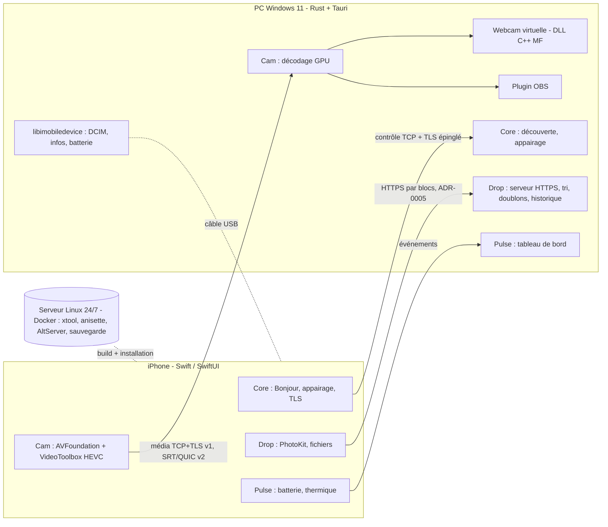
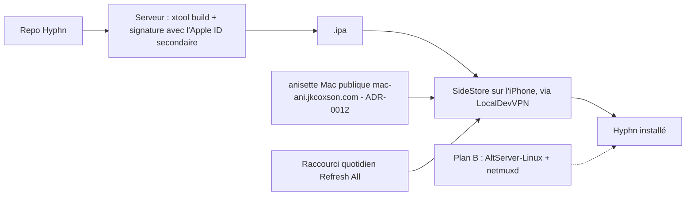

# Architecture

Version vivante de [[CAHIER]] section 7. Différences avec le cahier : marquées « ADR ».

## Trois machines, un protocole
L'iPhone et le PC se parlent **directement** sur le réseau local. Le serveur Linux construit, signe et héberge l'infra (anisette, AltServer, sauvegarde), mais n'est **jamais** nécessaire pour streamer ou transférer.



Le QR code affiché par le PC contient : IP, port, empreinte du certificat du PC, jeton à usage unique. L'iPhone le scanne, se connecte, vérifie l'empreinte, puis les deux gardent l'empreinte de l'autre (comme LocalSend et KDE Connect, mais sans PIN).

## Stack
| Partie | Choix | Pourquoi |
|---|---|---|
| App iPhone | Swift 6, SwiftUI, AVFoundation, VideoToolbox, PhotoKit, Network.framework | Natif = pleine qualité caméra et meilleure efficacité énergétique |
| Build iPhone | xtool (paquet SwiftPM + `xtool.yml`) sur le serveur Linux | Pas de Mac |
| App PC | Rust + Tauri, FFmpeg (ou Media Foundation) pour le décodage GPU | Léger, rapide, bon pour le réseau ; Evan connaît déjà Tauri (SafeSweep) |
| Webcam virtuelle | DLL C++ Media Foundation, à partir de VCamSample | Seule API officielle sous Windows 11 |
| Protocole | Protobuf versionné dans `protocol/` | Un seul contrat pour iPhone, PC et plus tard Android |
| Infra | Docker Compose sur le serveur, dans `infra/` | Tout redémarre seul |

## Ce que la recherche ajoute (2026-10-29)
- **Drop** : envoi HTTPS par blocs vers un serveur du PC, pour que l'envoi continue en arrière-plan ([[ADR-0005 Drop par HTTPS et blocs]], proposé).
- **Cam** : recette de scrcpy pour la latence — pas de tampon côté PC par défaut, paquets avec leur taille en tête, un fil par socket, petit tampon seulement pour l'audio.
- **Webcam virtuelle** : `MFCreateVirtualCamera` exige Windows 11 (build 22000+) et le type `SoftwareCameraSource`. La DLL s'enregistre dans HKLM, donc **admin une fois** à l'installation ; la caméra est créée pour l'utilisateur courant, donc l'app tourne sans admin. Windows ajoute « Windows Virtual Camera » au nom.
- **xtool** : app en **un seul binaire, sans extension** (les extensions sont encore cassées) ; vérifier `xtool.yml` à la main, car une clé mal écrite est ignorée sans erreur.
- **Pulse par câble** : IORegistry `AppleSmartBattery`, lire aussi `BatteryData` ([[ADR-0006 Sante batterie par cable]]).

## Build et installation (phase 0)

Règles : toujours le même Apple ID secondaire (sinon les données du Keychain sont perdues) ; 3 apps actives maximum, SideStore compris ; mode développeur et code de verrouillage obligatoires ; si le rafraîchissement rate 7 jours, l'app ne s'ouvre plus mais rien n'est perdu.

## Organisation du repo
```
CLAUDE.md · README.md
.claude/       skills, hooks, agents, rules
.githooks/     commit-msg
tools/         check-docs.ps1
docs/          vault Obsidian (ADR-0002)
protocol/      .proto + doc du protocole      (phase 1)
apps/ios/      SwiftPM + xtool.yml            (phase 0 : Hello)
apps/desktop/  Rust + Tauri                   (phase 1)
apps/desktop-vcam/  DLL C++ webcam virtuelle  (phase 5)
apps/obs-plugin/                              (phase 5)
infra/         un docker-compose par service : anisette/, altserver/  (phase 0, voir Serveur.md)
apps/android/                                 (phase 7)
```
Les dossiers n'existent qu'à partir de la phase indiquée : pas de dossier vide.

Liens : [[RULES]], [[VISION]], [[00-Accueil]]
