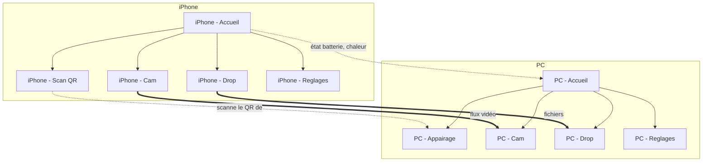

# Maquettes — index

## V2 visuelle — la référence (validée par Evan le 2026-10-31)
Maquettes cliquables, avec animations et états (bouton Play, réglage « Tweaks ») : [[ADR-0016 Design visuel V2]].
- **PC** (Accueil, Cam, Drop, Appairage, Réglages) : https://claude.ai/artifact/STaU5yYjqD5DsSy6vdATmr
- **iPhone** (Bienvenue, Scan QR, Accueil, Cam, Drop, Envoi, Réglages) : https://claude.ai/artifact/1etdZqrAwQWpN31xwQMYFN

Changements de fond par rapport aux notes ci-dessous : pas de page pour les infos de l’iPhone ([[ADR-0017 Pulse integre sans page]], [[ADR-0021 Plus de module Pulse]]) ; pas de micro, Cam démarre en pause, aperçu plein écran sur l'iPhone ([[ADR-0018 Cam image seule et demarrage en pause]]) ; Drop iPhone en 3 onglets (Tout, Photos, Fichiers) ; menu du haut sur le PC, onglets sur l'iPhone.

## V1 texte (phase 0) — à remettre à jour d'après la V2
Maquettes en texte et Mermaid. Elles fixent le contenu et l'ordre des écrans. Une note par écran, plus les parcours. Quand une note contredit la V2, la V2 a raison.

## Principes communs
- **Le PC est l'écran principal** : réglages, télémétrie, progression. L'iPhone reste simple, sombre et économe (règles d'énergie de [[RULES]]).
- Un écran = une tâche. Les réglages avancés sont repliés.
- Aucun chiffre inventé : une valeur inconnue s'affiche « — ».
- Textes en français, phrases courtes ; états vides, erreurs et « hors ligne » prévus sur chaque écran.

## Carte des écrans

## Écrans iPhone
- [[iPhone - Accueil]] — Cam et Drop, PC connecté ou non
- [[iPhone - Scan QR]] — appairage
- [[iPhone - Cam]] — avant le stream, puis écran noir
- [[iPhone - Drop]] — choisir et envoyer
- [[iPhone - Reglages]] — appareils appairés, énergie, aide

## Écrans PC
- [[PC - Accueil]] — appareils et raccourcis
- [[PC - Appairage]] — le QR code
- [[PC - Cam]] — aperçu, réglages, télémétrie
- [[PC - Drop]] — réception, tri, progression, historique
- [[PC - Reglages]] — dossiers, webcam, démarrage

## Parcours
- [[Parcours - Scan QR]] — premier appairage puis reconnexion
- [[Parcours - Stream]] — de « Démarrer » à Discord / OBS, avec la baisse thermique
- [[Parcours - Transfert]] — Wi-Fi ou câble, coupure et reprise
- [[Parcours - Liaison par cable]] — iPhone branché : liaison sans QR, retour au Wi-Fi débranché

Liens : [[00-Accueil]], [[VISION]]
