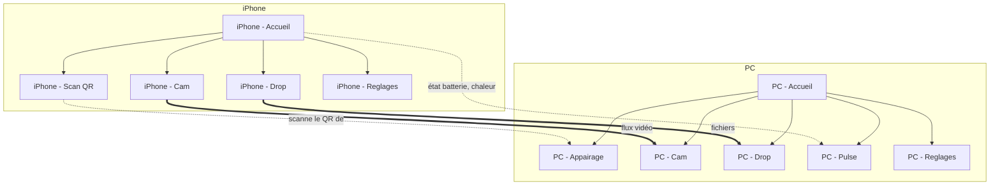

# Maquettes — index

Maquettes en texte et Mermaid (phase 0), **à valider par Evan**. Elles fixent le contenu et l'ordre des écrans, pas le style : le design visuel viendra avant le code de chaque phase. Une note par écran, plus les parcours.

## Principes communs
- **Le PC est l'écran principal** : réglages, télémétrie, progression. L'iPhone reste simple, sombre et économe (règles d'énergie de [[RULES]]).
- Un écran = une tâche. Les réglages avancés sont repliés.
- Aucun chiffre inventé : une valeur inconnue s'affiche « — ».
- Textes en français, phrases courtes ; états vides, erreurs et « hors ligne » prévus sur chaque écran.

## Carte des écrans

## Écrans iPhone
- [[iPhone - Accueil]] — trois tuiles Cam / Drop / Pulse, PC connecté ou non
- [[iPhone - Scan QR]] — appairage
- [[iPhone - Cam]] — avant le stream, puis écran noir
- [[iPhone - Drop]] — choisir et envoyer
- [[iPhone - Reglages]] — appareils appairés, énergie, aide

## Écrans PC
- [[PC - Accueil]] — appareils et raccourcis
- [[PC - Appairage]] — le QR code
- [[PC - Cam]] — aperçu, réglages, télémétrie
- [[PC - Drop]] — réception, tri, progression, historique
- [[PC - Pulse]] — tableau de bord de l'iPhone
- [[PC - Reglages]] — dossiers, webcam, démarrage

## Parcours
- [[Parcours - Scan QR]] — premier appairage puis reconnexion
- [[Parcours - Stream]] — de « Démarrer » à Discord / OBS, avec la baisse thermique
- [[Parcours - Transfert]] — Wi-Fi ou câble, coupure et reprise

Liens : [[00-Accueil]], [[VISION]]
