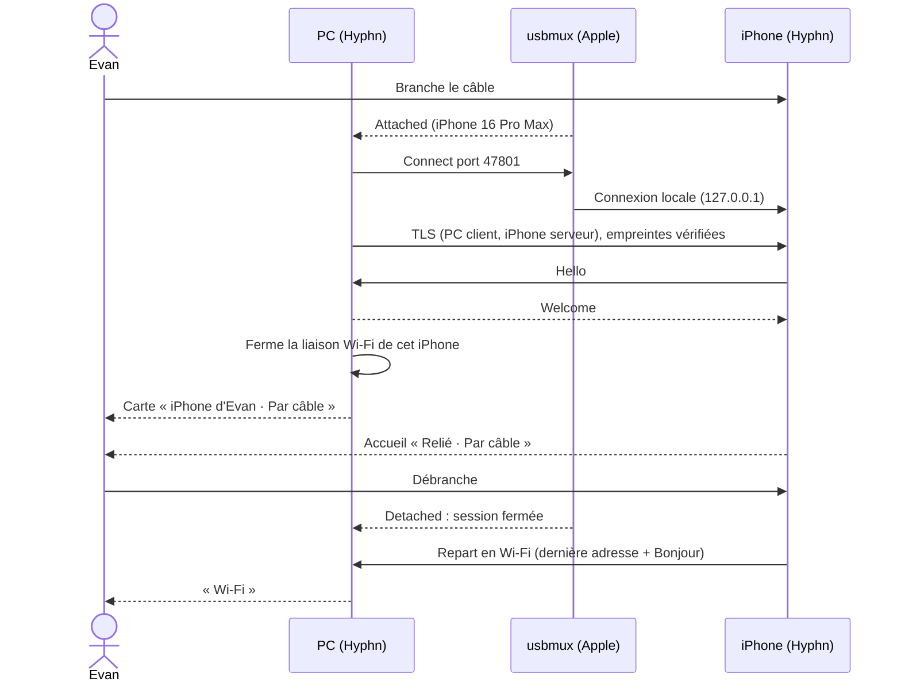
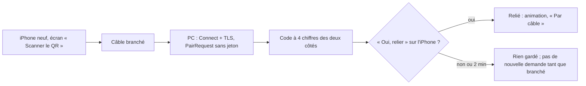

# Parcours — Liaison par câble

Spec : [[Core - Liaison par cable]]. Brancher remplace le QR et le Wi-Fi ; débrancher revient au Wi-Fi sans geste.

## iPhone déjà relié


## Premier appairage par câble (sans QR)


## Écrans touchés
```
iPhone - Scan QR                    iPhone - Accueil
┌──────────────────────────┐        ┌──────────────────────────┐
│ Scanner le QR du PC      │        │ ● Relié à PC-EVAN        │
│ [   viseur caméra    ]   │        │   Par câble   ⌁          │
│ ou branche le câble      │        │ ...                      │
└──────────────────────────┘        └──────────────────────────┘

PC - Accueil (carte iPhone)         PC - Réglages (sans pilote Apple)
┌──────────────────────────┐        ┌──────────────────────────────────┐
│ iPhone d'Evan  ● ⌁ Câble │        │ Câble : installe Apple Devices   │
│ 82 %  · normal · 112 Go  │        │ (Microsoft Store) ou iTunes.     │
└──────────────────────────┘        └──────────────────────────────────┘
```
Le libellé « Par câble » / « Wi-Fi » remplace seulement le petit texte sous le point vert ; rien d'autre ne bouge ([[ADR-0016 Design visuel V2]]).

Écrans : [[iPhone - Scan QR]], [[iPhone - Accueil]], [[PC - Accueil]], [[PC - Reglages]] · Index : [[Maquettes - Index]]
