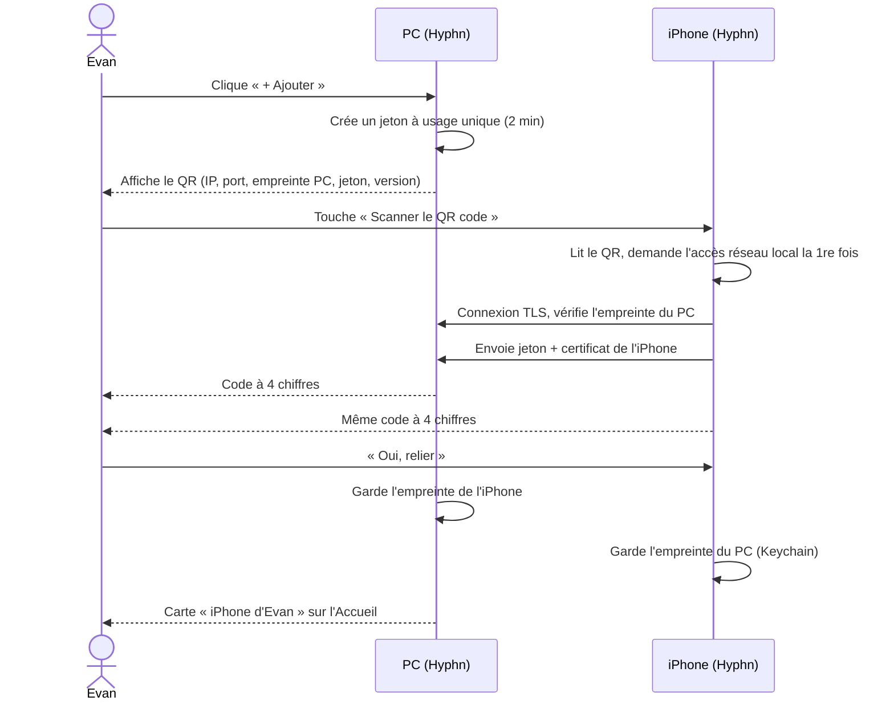
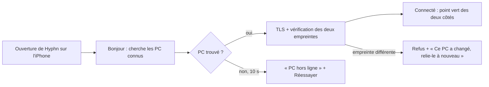

# Parcours — Scan QR (appairage)

Objectif de la phase 1 : l'iPhone apparaît sur le PC **en moins de 3 s** après le scan, et **sans re-scan** au lancement suivant.

## Premier appairage

## Les fois suivantes

Écrans : [[PC - Appairage]], [[iPhone - Scan QR]], [[iPhone - Accueil]] · Index : [[Maquettes - Index]]
