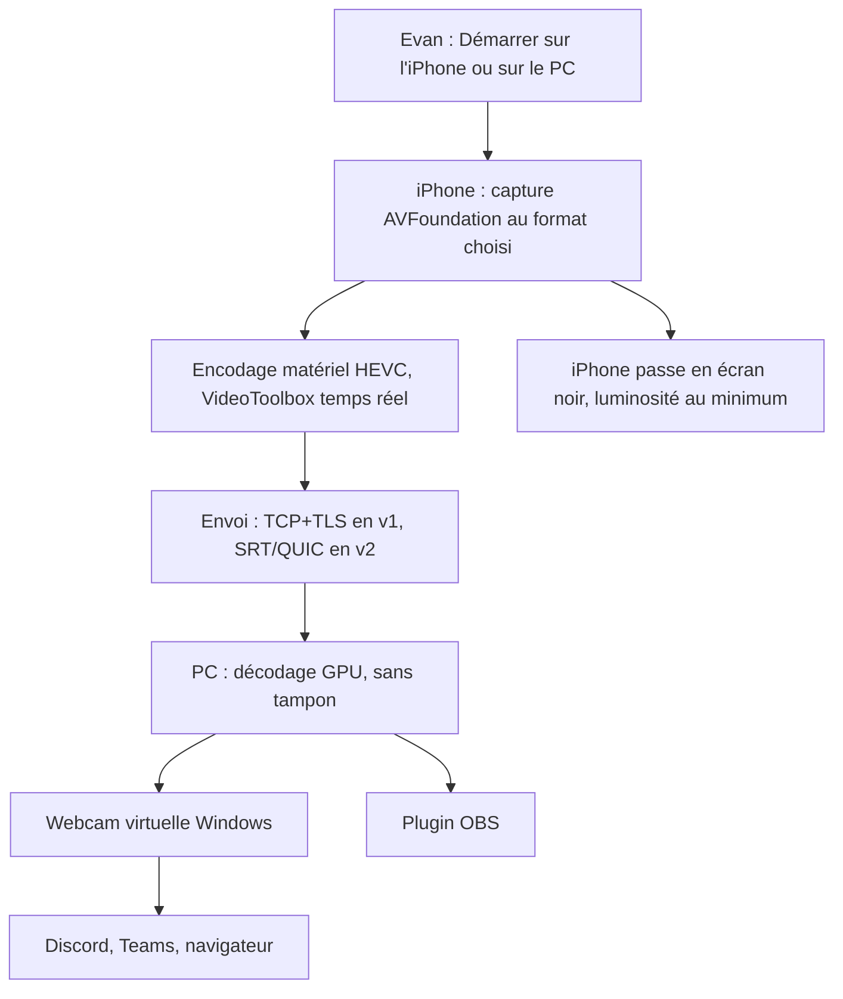
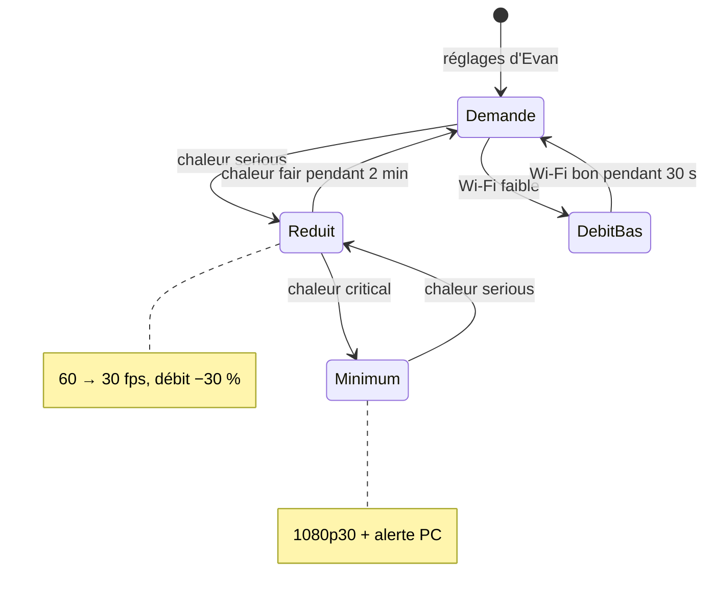

# Parcours — Stream (Cam)

De « Démarrer » à une caméra visible dans Discord ou OBS, avec la baisse automatique quand l'iPhone chauffe.

## Quand ça chauffe ou que le Wi-Fi faiblit

Les durées (2 min, 30 s) évitent que la qualité monte et descende sans arrêt ; elles seront ajustées après les mesures de la phase 5.

## Arrêts
- Evan touche « Arrêter » (iPhone) ou ■ (PC) → les deux côtés s'arrêtent, la webcam virtuelle affiche une image « Hyphn Cam en pause ».
- Appel téléphonique ou autre app au premier plan → iOS coupe la caméra → le PC affiche « Caméra de l'iPhone interrompue » et reprend seul au retour.

Écrans : [[iPhone - Cam]], [[PC - Cam]] · Index : [[Maquettes - Index]]
