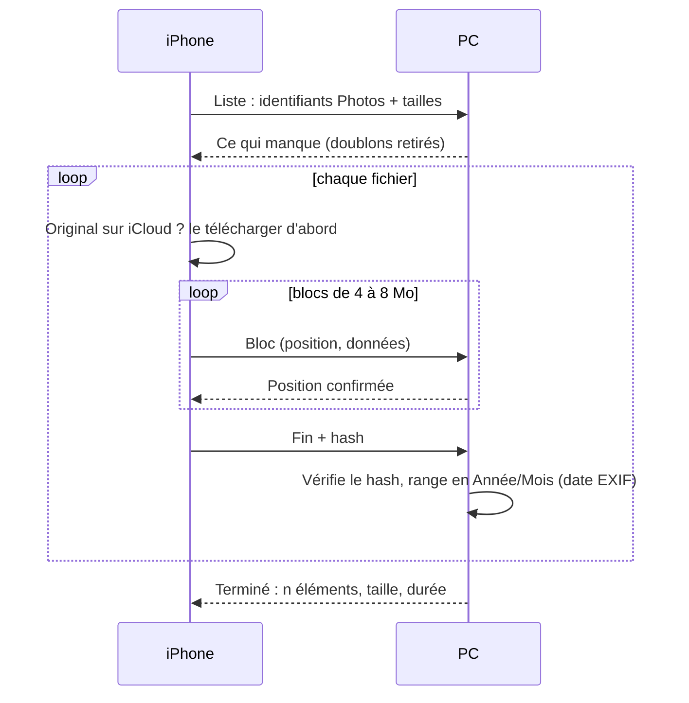
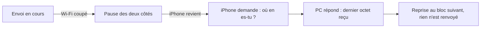
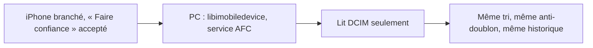

# Parcours — Transfert (Drop)

Deux chemins, un seul écran PC : [[PC - Drop]].

## Par Wi-Fi (app iPhone ouverte)

## Coupure et reprise

Preuve de la phase 3 : couper le Wi-Fi en plein transfert, reprendre, et vérifier dans les journaux qu'aucun bloc déjà reçu n'a été renvoyé.

## Par câble (app iPhone fermée)

Limite : par câble on n'a que DCIM (pas les albums, pas les originaux modifiés de Photos) ; l'écran le dit.

Écrans : [[iPhone - Drop]], [[PC - Drop]] · Index : [[Maquettes - Index]]
